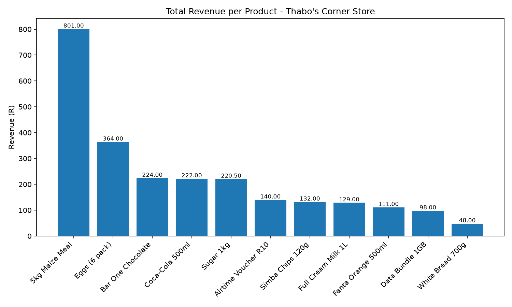
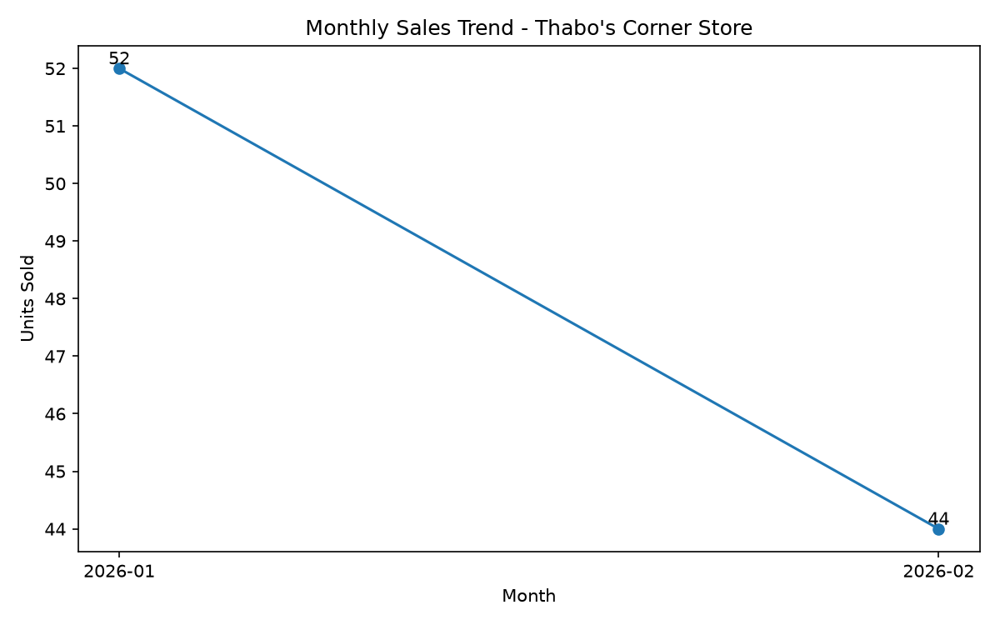

# Thabo's Corner Store - Sales Insights System

## Project overview

This Python project cleans the store's product and sales data, saves the
cleaned records in a relational SQLite database, calculates business
summaries, creates charts, and asks for a password before running the reports.
It demonstrates data cleaning, SQL, Python programming fundamentals,
visualisation, and basic access control.

## Project files

The raw CSV files must remain in the repository's `data` folder, next to
`starter_code`. The program reads them using paths relative to its working
directory:

```text
km04-05_store/
|-- data/
|   |-- products.csv
|   `-- sales.csv
`-- starter_code/
    |-- main.py
    |-- data_cleaning.py
    |-- database.py
    |-- analysis.py
    |-- visualize.py
    |-- security.py
    `-- requirements.txt
```

## Installation and running

Python 3.10 or later is required. From the repository root, create a virtual
environment and install the dependencies:

```powershell
python -m venv .venv
.\.venv\Scripts\Activate.ps1
python -m pip install -r starter_code\requirements.txt
```

Run the program from `starter_code` so that it can find the data folder and
save its outputs in the expected location:

```powershell
cd starter_code
python main.py
```

At the password prompt, enter `letmein` (the demonstration password). The
password input is hidden. After successful login, the program writes or
updates `store.db` and creates `revenue_per_product.png` and
`monthly_trend.png` in the current folder. The login gate allows three
attempts.

## Task 2: Data-cleaning decisions

The product CSV contained 16 rows; cleaning retained 12. Rows with a missing
price were dropped because there is no reliable value for revenue calculations.
The row without a product name was dropped because it cannot be identified.
One exact duplicate product row was removed, and category names were
standardised to title case.

The sales CSV contained 71 rows; cleaning retained 43. Dates in ISO
year-month-day format were kept, and slash- or hyphen-separated dates were
interpreted as day-month-year (for example, `02/01/2026` means 2 January
2026). This consistent day-first rule suits the South African context and
avoids silently guessing for ambiguous dates. Rows with missing or
unparseable dates, missing or non-numeric quantities, or product IDs absent
from the cleaned product data were removed. The duplicate transaction row was
removed. Missing payment methods on retained rows were labelled `Unknown`
rather than guessed. Customer type is optional, so missing values were kept.
The original CSV files are not changed.

## Task 3: Relational database and SQL results

The program creates two SQLite tables. `products` has `product_id` as its
primary key and stores the product name, category, and unit price. `sales` has
`sale_id` as its primary key and a `product_id` foreign key referring to
`products`; it also stores quantity, date, payment method, and optional
customer type. The generated database file is `starter_code/store.db`.

The five queries below are implemented in `database.py`. Results are from the
cleaned data. Revenue is in rand (R).

### 1. Revenue by product name

This query joins sales to products and sums quantity times unit price. It
groups on `product_name`, so the two Coca-Cola IDs are combined into one
result.

```sql
SELECT p.product_name,
       ROUND(SUM(s.quantity * p.unit_price), 2) AS total_revenue
FROM sales s
JOIN products p ON s.product_id = p.product_id
GROUP BY p.product_name
ORDER BY total_revenue DESC;
```

| Product             | Revenue (R) |
| ------------------- | ----------: |
| 5kg Maize Meal      |      801.00 |
| Eggs (6 pack)       |      364.00 |
| Bar One Chocolate   |      224.00 |
| Coca-Cola 500ml     |      222.00 |
| Sugar 1kg           |      220.50 |
| Airtime Voucher R10 |      140.00 |
| Simba Chips 120g    |      132.00 |
| Full Cream Milk 1L  |      129.00 |
| Fanta Orange 500ml  |      111.00 |
| Data Bundle 1GB     |       98.00 |
| White Bread 700g    |       48.00 |

### 2. Best-selling product by units

```sql
SELECT p.product_name, SUM(s.quantity) AS total_quantity
FROM sales AS s
JOIN products AS p ON s.product_id = p.product_id
GROUP BY p.product_id, p.product_name
ORDER BY total_quantity DESC
LIMIT 1;
```

| Product           | Units sold |
| ----------------- | ---------: |
| Bar One Chocolate |         16 |

### 3. Transactions by payment method

```sql
SELECT payment_method, COUNT(*) AS transaction_count
FROM sales
GROUP BY payment_method
ORDER BY transaction_count DESC, payment_method;
```

| Payment method | Transactions |
| -------------- | -----------: |
| Cash           |           14 |
| Mobile Money   |           11 |
| Card           |           10 |
| Unknown        |            8 |

### 4. Revenue by product category

```sql
SELECT p.category,
       ROUND(SUM(s.quantity * p.unit_price), 2) AS category_revenue
FROM sales AS s
JOIN products AS p ON s.product_id = p.product_id
GROUP BY p.category
ORDER BY category_revenue DESC;
```

| Category       | Revenue (R) |
| -------------- | ----------: |
| Household      |    1,021.50 |
| Dairy          |      493.00 |
| Snacks         |      356.00 |
| Beverages      |      333.00 |
| Airtime & Data |      238.00 |
| Bakery         |       48.00 |

### 5. Average sale quantity by customer type

```sql
SELECT customer_type, ROUND(AVG(quantity), 2) AS average_quantity
FROM sales
WHERE customer_type IS NOT NULL
GROUP BY customer_type
ORDER BY average_quantity DESC;
```

| Customer type | Average units per sale |
| ------------- | ---------------------: |
| Regular       |                   2.33 |
| Walk-in       |                   2.17 |

## Task 4: Programming logic and analysis

The analysis uses Python functions, loops, conditionals, lists, and
dictionaries. On the cleaned data it reports 43 sales records, flags Data
Bundle 1GB as out of stock, totals 52 units sold in January 2026 and 44 in
February 2026, and calculates an average basket size of 2.23 units per sale.

## Task 5: Charts

The bar chart compares revenue by product name. 5kg Maize Meal has the
highest displayed revenue, and the two Coca-Cola product IDs are combined as
one name in this chart, matching the SQL query.



The line chart compares units sold by month: 52 in January and 44 in
February 2026.



## Task 6: Data security and CIA-triad reflection

The login gate hashes the entered password with SHA-256, compares hashes with
`hmac.compare_digest`, and allows up to three attempts. The demonstration
hash is hardcoded in `security.py`, and the demonstration password is
`letmein`. The gate does not encrypt the database or stop someone from opening the files directly.

**Confidentiality:** The gate provides a basic barrier to casual access to the
reports, while `getpass` hides the password as it is typed.
the password should be a strong credential managed outside the source code,
and report and database access should be restricted to authorised users.

**Integrity:** The gate does not stop someone from changing the CSV or
database files. The database uses primary keys for product and sale IDs and
a foreign key so a sale refers to a product in the products table. Cleaning
also removes incomplete or invalid records before insertion. These choices
help keep records consistent, but they do not prevent intentional file
tampering.

**Availability:** Because the database and charts are stored on one
computer, hardware failure, loss, or damage could make the reports
unavailable. Keeping regular backups of the source data, database, and
project files in a separate, access-controlled location would reduce this
risk.

## Key Business Insights

The cleaned records show 43 valid sales across 12 products. Maize meal
earned the most revenue at R801, followed by eggs at R364. Bar One Chocolate
earned R224 and was also the best-selling item by quantity, with 16 units
sold. Household products brought in the most revenue by category at
R1,021.50, ahead of Dairy at R493 and Snacks at R356. Keeping popular
everyday items such as maize meal, eggs, and Bar One available should help
avoid missed sales.

Customers bought 52 units in January and 44 in February. This is a decrease
of eight units, so it may be worth checking whether February demand was
affected by stock availability or fewer customers; two months of data are
not enough to assume this is a long-term trend. Each transaction averaged
2.23 units, a useful baseline if you try offers that encourage customers to
buy an extra item.

Cash was used in 14 transactions, Mobile Money in 11, and card in 10.
Another eight transactions have no recorded payment method. Asking staff to
record this information consistently would make future payment summaries
more useful. Data Bundle 1GB is the only item currently marked out of stock,
so it is the clearest product to reorder. These results are a practical
starting point for stock and sales decisions; updating the records regularly
will make the comparisons more valuable.
